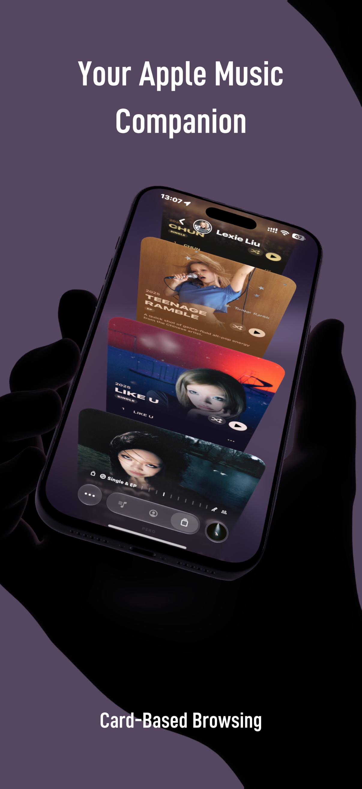
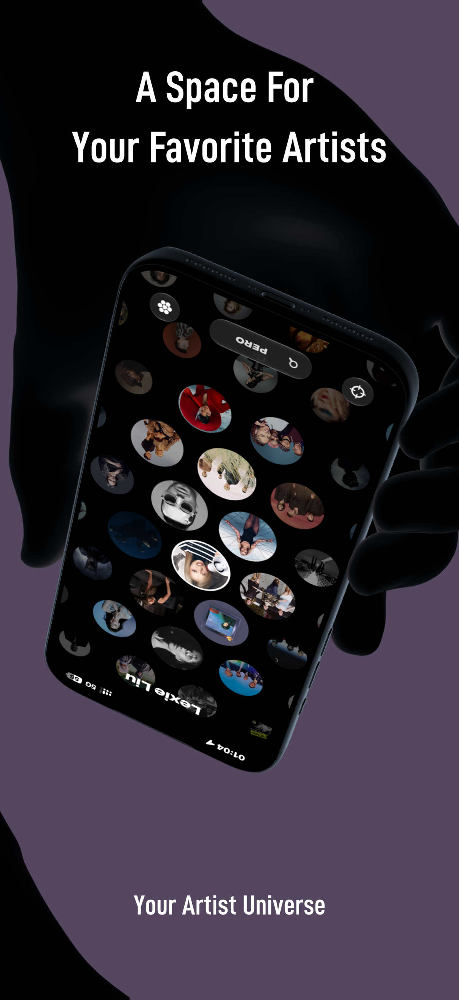
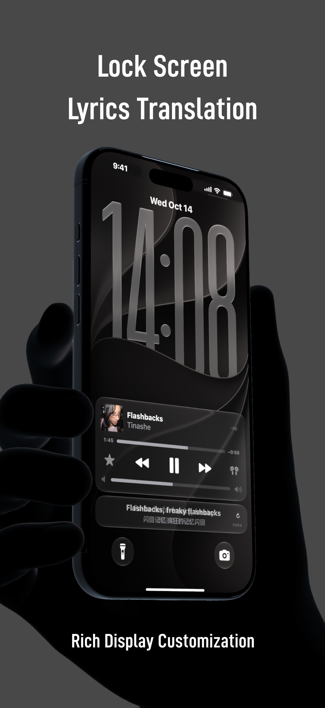
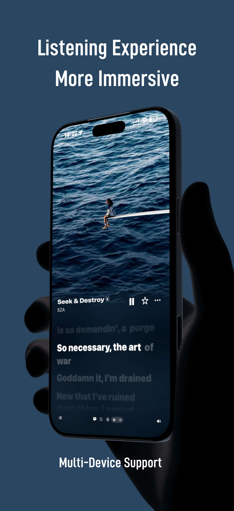

# PERO

**Your Apple Music companion. Built around your artists.**

[简体中文](README.md) · English

PERO is a music app for iPhone and iPad. Start with an artist you love and find their albums, songs, playlists, and your music notes in one place.

<table>
  <tr>
    <td></td>
    <td></td>
  </tr>
  <tr>
    <td></td>
    <td></td>
  </tr>
</table>

## Inside PERO

- **Start with your artists**: browse albums and songs in cards, and keep the artists you love close.
- **Settle into the music**: enjoy immersive artwork, word-by-word lyrics, and translations.
- **Keep lyrics nearby**: follow along on the Lock Screen, in Dynamic Island, through Live Activities, or in a floating window.
- **Shape your next listen**: collect songs in the song basket, arrange their order, and create playlists.
- **Keep a music note**: save a feeling, a review, or a rating for a song or album.
- **Continue on another device**: use PERO Flow for remote playback control and playback handoff.

## Made for Apple devices

Designed for iPhone and iPad running iOS / iPadOS 26 or later, with a multilingual interface.

Built with Swift, UIKit, MusicKit, ActivityKit, WidgetKit, and CloudKit.

Playing Apple Music content requires the relevant authorization and subscription. Content and some features depend on region, device, and system support.

## Feedback

Found a problem or have an idea? [Send feedback](https://github.com/kkdli/PERO/issues/new/choose). Include your use case, device, system version, and steps to reproduce when relevant.

## About this repository

**PERO is a closed-source application.** This repository is for product presentation and feedback. It does not contain the application source code or grant an open-source license to it.

Music, artwork, artist images, and related content shown in screenshots belong to their respective rights holders.
