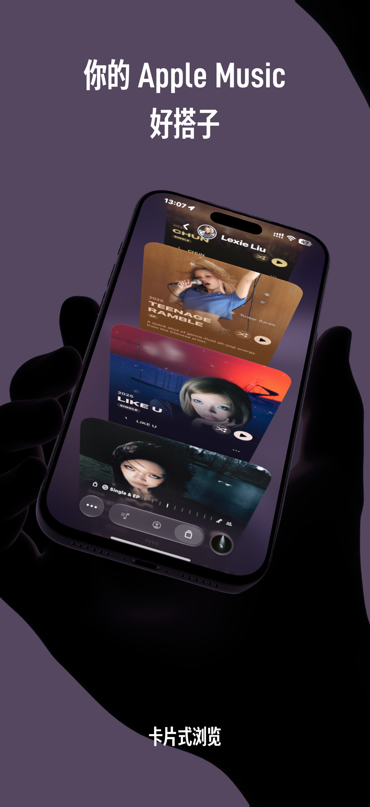
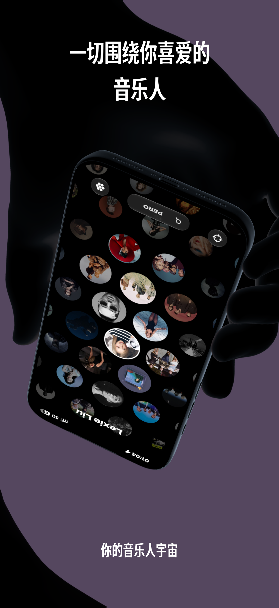
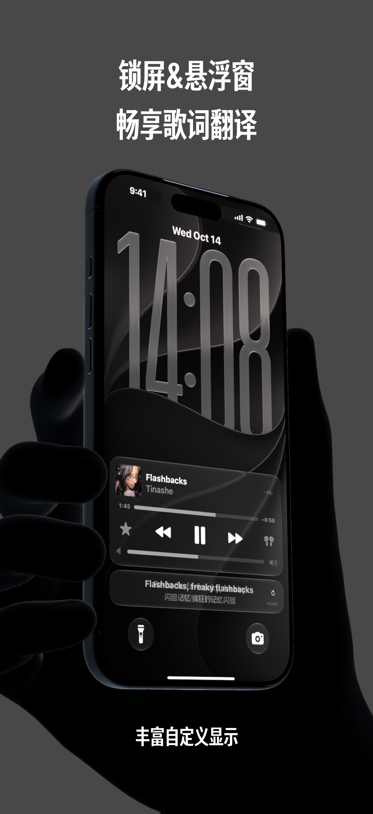

# PERO

**你的 Apple Music 好搭子，一切围绕你喜爱的音乐人。**

简体中文 · [English](README.en.md)

PERO 是为 iPhone 和 iPad 打造的音乐应用。以音乐人为起点，把专辑、歌曲、歌单和你留下的音乐笔记放在一起，让喜欢的音乐更容易找到，也更值得停留。

<table>
  <tr>
    <td></td>
    <td></td>
  </tr>
  <tr>
    <td></td>
    <td></td>
  </tr>
</table>

## 在 PERO 里

- **从音乐人开始**：在卡片中浏览专辑与歌曲，把喜欢的音乐人留在身边。
- **沉浸地听**：让封面、逐字歌词和翻译陪着音乐展开。
- **歌词随身**：通过锁屏、灵动岛、实时活动和悬浮窗继续查看歌词。
- **整理想听的歌**：用选歌篮挑选歌曲、调整顺序、创建歌单。
- **留下音乐笔记**：为歌曲和专辑记录感受、乐评与评分。
- **换台设备继续**：通过 PERO Flow 跨设备遥控与接续播放。

## 为 Apple 设备打造

面向 iOS / iPadOS 26 及以上版本，适配 iPhone 与 iPad，提供多语言界面。

使用 Swift、UIKit、MusicKit、ActivityKit、WidgetKit 和 CloudKit 等 Apple 原生技术构建。

Apple Music 内容的播放需要相应的授权与订阅，内容及部分功能的可用性取决于所在地区、设备和系统支持。

## 反馈与建议

遇到问题或有想法，欢迎[提交反馈](https://github.com/kkdli/PERO/issues/new/choose)。描述使用场景、设备、系统版本和复现步骤，会更方便定位问题。

## 关于这个仓库

**PERO 是闭源应用。** 本仓库用于产品展示和问题反馈，不包含应用源码，也不授予应用源码的开源许可。

截图中的音乐、封面、艺人图片与相关内容，其权利归各自权利人所有。
